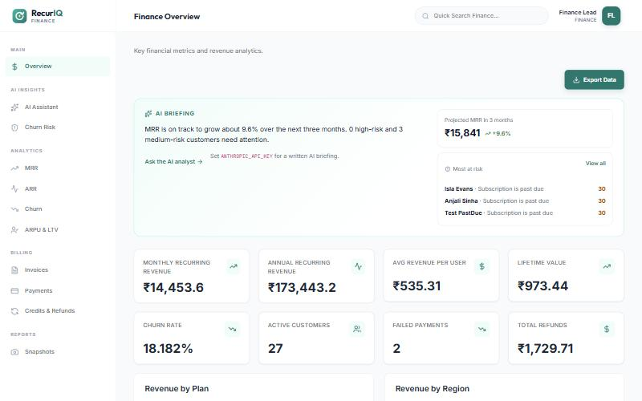
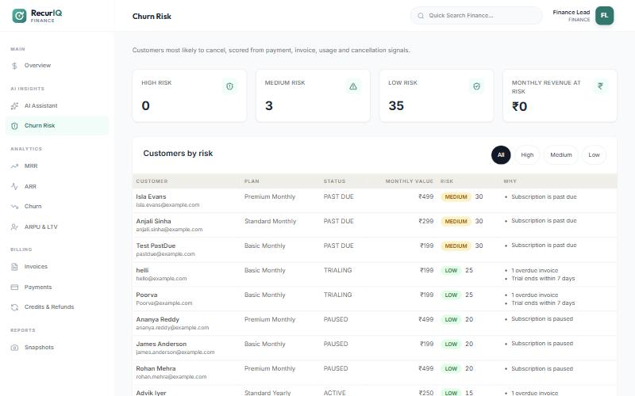
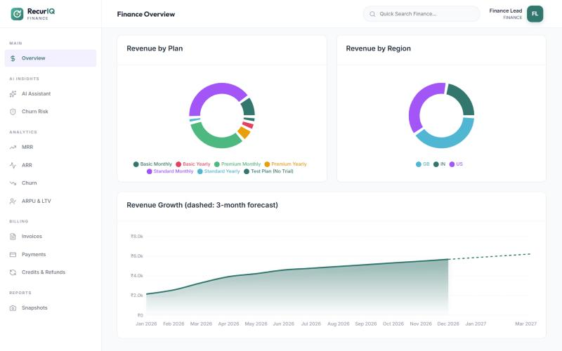
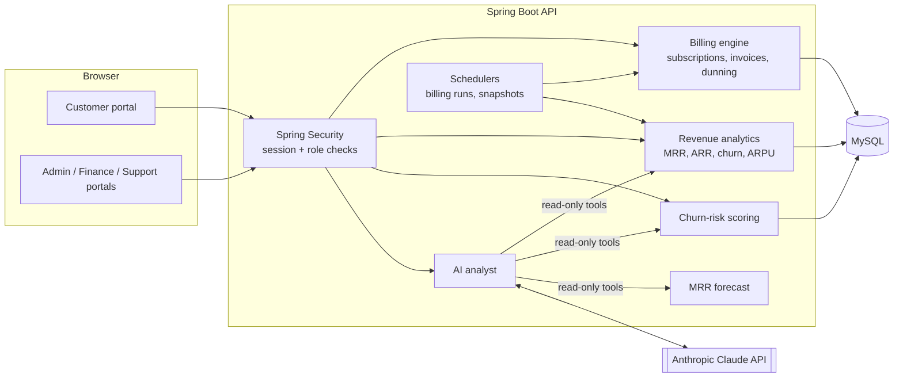

# RecurIQ

**AI-assisted subscription billing and revenue management.**

RecurIQ runs the full billing cycle for subscription businesses: plans, trials, proration, invoicing, taxes, coupons, dunning and usage-based billing. It also adds an **AI billing analyst** that answers questions about revenue in plain English, **explainable churn-risk scoring**, and an **MRR forecast**. The demo data belongs to *StreamFlix*, a fictional streaming service that bills its customers through RecurIQ.

[](https://github.com/chehakmiglani/recuriq/actions/workflows/ci.yml)
     



## Highlights

| | |
|---|---|
| **AI billing analyst** | Finance and admin staff ask questions such as *"Why did MRR change last month?"* and get answers built from live data, with the data sources listed under each answer. |
| **AI briefing** | The finance overview opens with a short written summary of how revenue is doing, where it's heading, the biggest risk and one action to take. |
| **Churn-risk scoring** | Every live subscription gets a 0–100 risk score with the reasons behind it, plus the monthly revenue at risk. |
| **MRR forecast** | A 3-month projection drawn as a dashed line on the revenue chart. |
| **Billing engine** | Subscription lifecycle, proration, invoices and credit notes (PDF), regional tax, coupons, dunning retries and metered usage. |
| **Role-based portals** | Separate Customer, Admin, Finance and Support apps, with role checks enforced on every API endpoint. |

<table>
  <tr>
    <td></td>
    <td></td>
  </tr>
  <tr>
    <td align="center">Churn risk with reasons</td>
    <td align="center">Revenue trend with forecast</td>
  </tr>
</table>

## Architecture



## How the AI works

**The analyst** uses Claude's *tool use*. Claude never sees the database or writes SQL. It gets ten read-only tools that wrap the existing analytics services (dashboard KPIs, MRR/ARR/churn/ARPU reports, churn-risk scores, invoices, payments, refunds). For each question it picks the tools it needs, the backend runs them, and Claude writes the answer from the returned figures. Every tool call is listed under the answer so the numbers can be checked.

**The briefing** is one Claude call over a JSON snapshot of the dashboard, forecast and churn risk. It is cached for 30 minutes so opening the dashboard doesn't cost an API call each time.

**Churn risk and the forecast don't use the API.** They are deterministic, so they run without a key and can be unit-tested:

| Churn signal | Points |
|---|---|
| Pending cancellation request / set to cancel at period end | +35 each |
| Subscription past due | +30 |
| Subscription paused | +20 |
| Failed payments in the last 90 days | +12 each (max +36) |
| Overdue open invoice | +15 |
| Usage down more than 50% vs. the previous 30 days | +15 |
| Trial ends within 7 days | +10 |
| New customer (< 60 days) | +5 |
| Customer for over a year / consistent on-time payments | −10 each |

Scores of 60 and above are **High** risk, 30–59 are **Medium**. The forecast fits a least-squares trend line through the last six months of MRR snapshots.

Without an `ANTHROPIC_API_KEY`, the analyst page explains how to turn it on, the briefing falls back to a rule-based summary, and everything else works normally.

## Tech stack

| Layer | Technology |
|---|---|
| Backend | Java 17, Spring Boot 3.4, Spring Security, Spring Data JPA, Bean Validation, OpenPDF, springdoc-openapi |
| AI | Anthropic Claude API via the official Java SDK (tool use) |
| Frontend | React 19, TypeScript, Vite, React Router, Bootstrap 5, Recharts, Lucide icons |
| Database | MySQL 8 |
| Tooling | JUnit 5 + Mockito (590+ tests), GitHub Actions, Docker Compose |

## Getting started

### Option A: Docker (one command)

```bash
docker compose up --build
```
Open `http://localhost:3000`. MySQL is created and seeded automatically. To turn on the AI features, set `ANTHROPIC_API_KEY` in your shell or in a `.env` file next to `docker-compose.yml` first.

### Option B: run locally

**Prerequisites:** JDK 17+, Maven 3.9+, Node.js 20+, MySQL 8, and optionally an [Anthropic API key](https://console.anthropic.com/).

1. **Database:** run `backend/src/main/resources/schema.sql`, then `data.sql`, against MySQL.
2. **Backend:**
   ```bash
   cd backend
   mvn spring-boot:run
   ```
   API on `http://localhost:8765`, Swagger UI on `http://localhost:8765/swagger-ui.html`.
3. **Frontend:**
   ```bash
   cd frontend
   npm install
   npm run dev
   ```
   Open `http://localhost:3000`. Staff portals are at `/management/login`; the seeded staff accounts and their demo password are listed at the top of `schema.sql`.

### Configuration

| Variable | Default | Purpose |
|---|---|---|
| `DB_URL` | `jdbc:mysql://localhost:3306/subscription_billing` | Database connection |
| `DB_USERNAME` / `DB_PASSWORD` | `root` / `root` | Database credentials |
| `ANTHROPIC_API_KEY` | *(unset)* | Turns on the AI analyst and briefing. Never commit it. |
| `RECURIQ_AI_MODEL` | `claude-opus-5-5` | Claude model used by the AI features |

## AI API

| Method | Endpoint | Roles | Description |
|---|---|---|---|
| `GET` | `/api/ai/status` | Finance, Admin, Support | Whether the AI analyst is configured |
| `POST` | `/api/ai/ask` | Finance, Admin | `{ "question": "...", "history": [...] }` → answer + data sources used |
| `GET` | `/api/ai/insights?refresh=false` | Finance, Admin | Forecast, top risks and the AI briefing |
| `GET` | `/api/ai/churn-risk?level=HIGH` | Finance, Admin, Support | Risk scores, reasons and revenue at risk |

The full API is documented in Swagger UI.

## Project structure

```
├── backend/            Spring Boot REST API (port 8765)
├── frontend/           React + Vite single-page app (port 3000)
├── docs/               Architecture notes, execution flows, test report, screenshots
├── docker-compose.yml  MySQL + API + web app
└── .github/workflows/  CI: backend tests and frontend build
```

## Documentation

- [Dunning architecture](docs/DUNNING_ARCHITECTURE.md)
- [Authentication & subscription flow](docs/AUTHENTICATION_AND_SUBSCRIPTION_FLOW.txt)
- [Test report](docs/Test_Report.md)

## Acknowledgements

Originally built as a team project during an internship; extended independently with the AI features, forecasting and RecurIQ product design.
